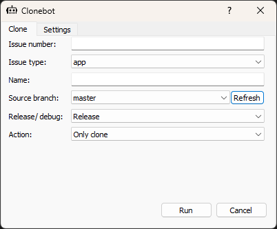
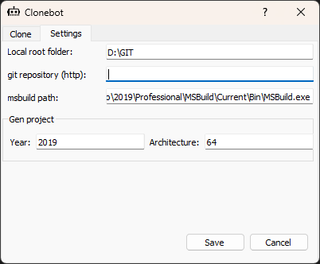

# Clone bot
Clone bot je jednoduchá desktopová aplikace vyvíjená v C++ Qt5.
- Lehký nástroj automatizuje přípravu aktuální verze projektu z gitu na lokální úložiště

# Funkce
1. Umožňuje sloučit více kroků:
- vytvoření lokálního adresáře projektu podle git adresářové struktury (project group / repo / source branch / issue branch)
- příkazy clone, create branch, switch branch
- stáhnutí dependencies/ balíčků
- generate solution (.sln, .vcproj)
- build ve Visual Studiu -> .exe

2. Umožnuje paralelně připravovat více projektů najednou

Settings uchovává v adresáři appdata aplikace vložené cesty a poslední uživatelské volby.

# Náhled aplikace:

